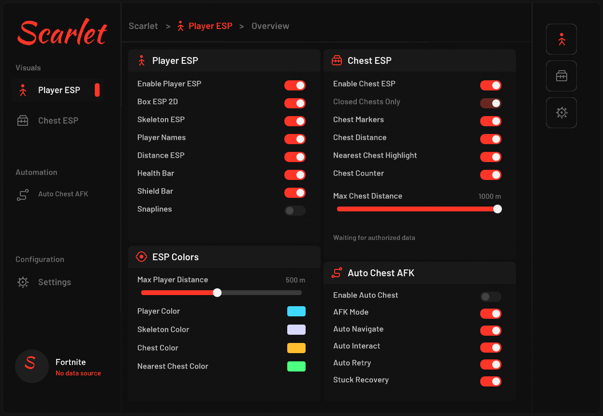

# Scarlet External — C++20 / ImGui / DirectX 11

Interface Scarlet baseada na referência visual: vermelho #FF3528, lettering manuscrito, sidebar, breadcrumb, duas colunas de cards, rail de ícones e controles próprios ImDrawList.

Esta imagem foi gerada a partir dos draw lists do menu C++ real, com rasterização em CPU. **Não é captura de Fortnite.** As fontes são aproximações licenciadas: a referência não forneceu a fonte/logo original.

## Baixar

- [Windows x64 — ScarletExternal.exe e assets (.zip)](https://raw.githubusercontent.com/Kevyn-Araujo/Disaster-Escape-LIVE-Fuja-ou-Morra-roblox-/main/scarlet-external/ScarletExternal_Windows_x64.zip)
- [Código-fonte completo, CMake, testes e documentação (.zip)](https://raw.githubusercontent.com/Kevyn-Araujo/Disaster-Escape-LIVE-Fuja-ou-Morra-roblox-/main/scarlet-external/ScarletExternal_Source.zip)
- [SHA-256](ScarletExternal_SHA256SUMS.txt)

## Abrir

Extraia todo o pacote e preserve assets/fonts junto ao executável. Abra Fortnite em janela/borderless e execute ScarletExternal.exe. INSERT alterna o menu, F6 inicia/para a automação e F8 aciona a emergência. O ícone da bandeja oferece saída.

O overlay implementa detecção por nome de executável, acompanhamento da área cliente, transparência, ocultação ao minimizar/perder foco e click-through com menu fechado.

**O modo padrão não inclui provider real de telemetria. Detectar a janela não fornece posições ou estados de entidades. ESP e Auto Chest não exibem dados inventados nem operam sobre Fortnite sem uma integração autorizada.** O menu informa No data source.

Para testar o ambiente controlado, execute Iniciar-DEMO.bat ou `ScarletExternal.exe --demo`. Esse modo é explicitamente identificado como MOCK/DEMO e usa a simulação independente; não envia comandos ao jogo.

## Verificado

- 19/19 grupos de testes do núcleo passaram.
- Controles ImGui exercitados com eventos de mouse, inclusive Save/Load JSON.
- CTest portátil: 3/3 suites passaram; ASan/UBSan sem diagnóstico.
- Compilação/link Windows x64 passou; ScarletExternal.exe é PE32+ GUI x86-64.
- **Execução gráfica no Windows e overlay sobre Fortnite ainda não foram executados neste ambiente Linux.** O teste de rastreamento de janela Windows foi compilado e incluído para execução local.

No código-fonte: README com VS2022, docs/VALIDATION.md com evidências e limitações, docs/INTEGRATION.md com contratos e requisitos para um provider autorizado. Sem DLL injetada, leitura da memória do jogo, offsets, drivers ou bypass.
