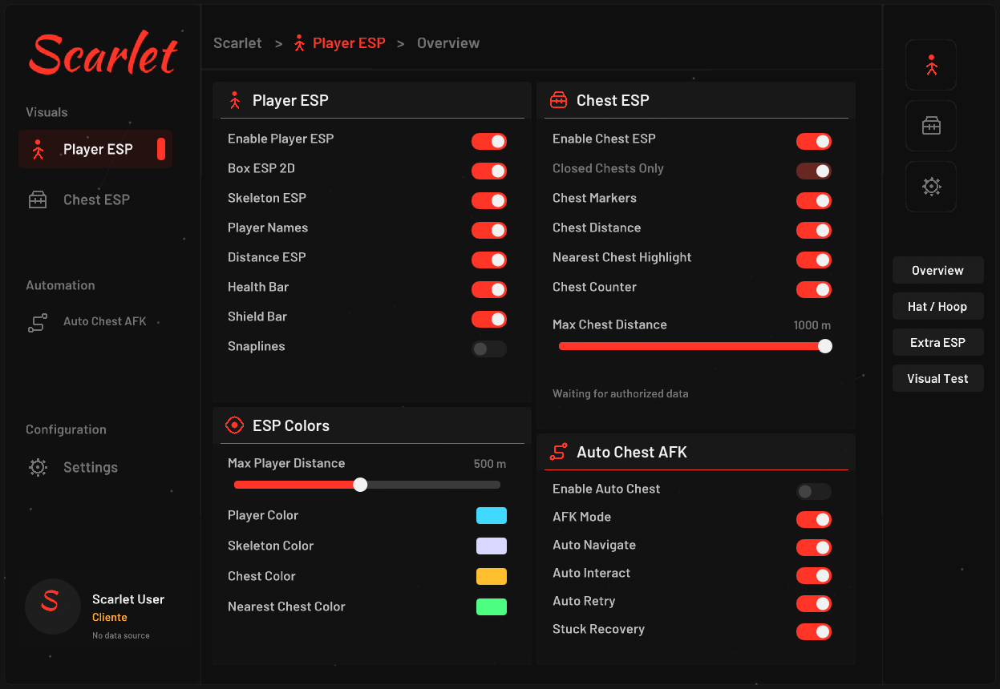
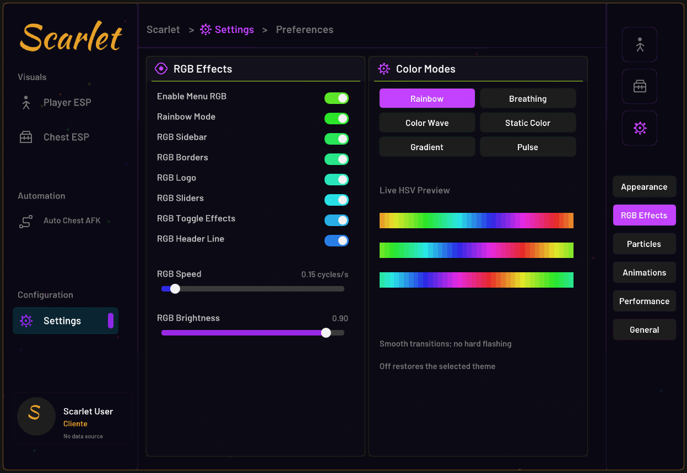
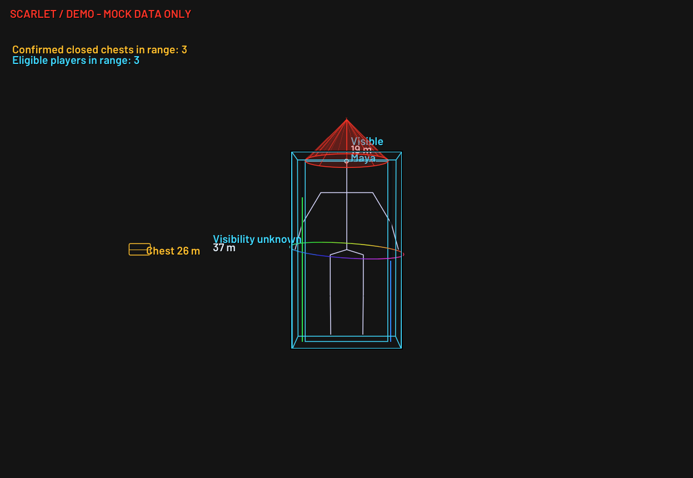

# Scarlet External — Premium UI V2

Atualização incremental do projeto Scarlet existente em C++20 / Dear ImGui / DirectX 11. A versão anterior permanece na pasta scarlet-external.

## Downloads

- [Windows x64 — ScarletExternal.exe + assets e testes (.zip)](https://raw.githubusercontent.com/Kevyn-Araujo/Disaster-Escape-LIVE-Fuja-ou-Morra-roblox-/main/scarlet-premium-v2/ScarletExternal_Premium_V2_Windows_x64.zip)
- [Código-fonte completo, dependências e relatório (.zip)](https://raw.githubusercontent.com/Kevyn-Araujo/Disaster-Escape-LIVE-Fuja-ou-Morra-roblox-/main/scarlet-premium-v2/ScarletExternal_Premium_V2_Source.zip)
- [Checksums SHA-256](Scarlet_Premium_V2_SHA256SUMS.txt)

## Interface

Prévias produzidas pelo mesmo código ImGui, rasterizado em CPU; não são capturas de Fortnite.

- Dez temas com transição e escolha salva automaticamente.
- Seis modos RGB, velocidade/brilho e alvos independentes.
- Opacidade de fundo, sidebar, cards, headers e bordas; composição live DirectComposition premultiplicada.
- Até100 partículas (padrão50), conexões limitadas, mouse, neve/pétalas/cores sazonais.
- Abertura220ms por DeltaTime, fade/scale/slide/ease out, fechamento curto e microanimações.
- Perfil local personalizável, preservado no canto inferior esquerdo.
- Chapéu cônico, bambolê3D, boxes3D/cantos/gradiente, outline/glow e cores RGB/distância.
- Performance Mode reduz partículas/geometria e desativa efeitos caros.

As novas seções de Settings e Player ESP ficam na coluna direita. General preserva os controles anteriores. Tema salva automaticamente; para outras opções use Save Config. JSON antigo continua compatível.

## Abrir sem Fortnite

Extraia todo o ZIP e preserve assets/fonts.

- Iniciar-DEMO.bat: aplicação de teste independente; INSERT menu, F6 iniciar/parar, F8 emergência.
- Testar-ESP.bat: teste de efeitos sobre dados mock; TAB menu, ESC parada, F4 iniciar/parar. Atalhos locais não disputam os globais da instância principal.
- Modo padrão ScarletExternal.exe: aguarda Fortnite em janela/borderless, INSERT mostra menu.

Sem cabeça/waist/bounds válidos, os respectivos efeitos são omitidos. Não há inferência de ossos ou entidades. **Não foi incluído provider real de Fortnite; ESP/coleta do jogo real continuam indisponíveis sem integração autorizada.** Demo é explicitamente identificada e não envia comandos ao jogo.

## Validação

- 19/19 grupos existentes +12/12 novos passaram, além dos controles reais ImGui e coleta simulada.
- CTest portátil4/4 e ASan/UBSan passaram, sem diagnóstico.
- Reabertura após intervalo longo possui regressão para não saltar a animação.
- Build/link Windows x64 passou, incluindo DirectComposition.
- Hashes confirmam Auto Chest, navegação e filtros preservados; ChestESP::render ficou byte a byte igual.
- **Execução gráfica em Windows/Fortnite ainda não foi realizada neste ambiente Linux.** Não foi medido impacto de FPS no jogo.

O pacote fonte contém README para VS2022, docs/V2_VALIDATION.md com resultados/limites e logs, além dos sete módulos solicitados. Fontes e bibliotecas vendorizadas com licenças. Sem bypass, drivers, offsets ou acesso à memória do jogo.
